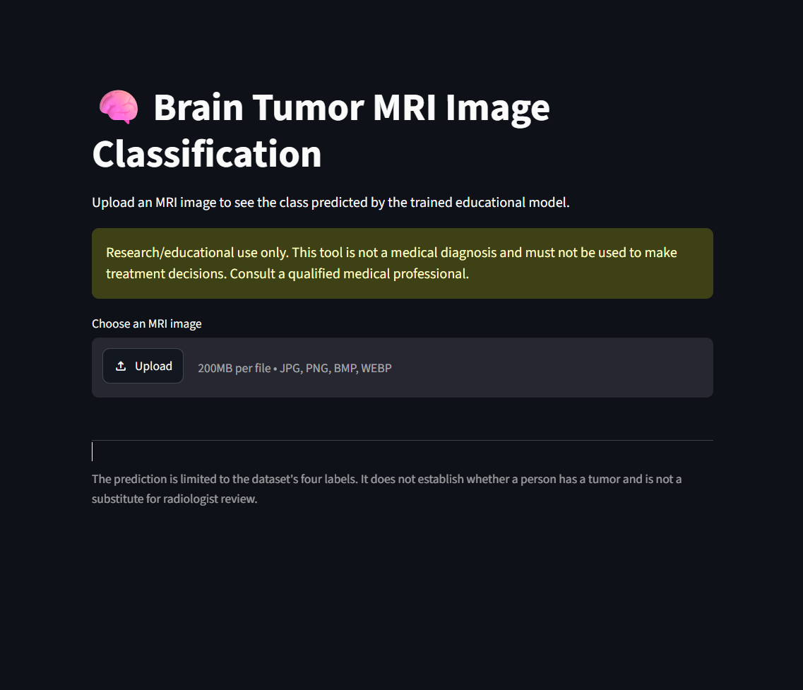
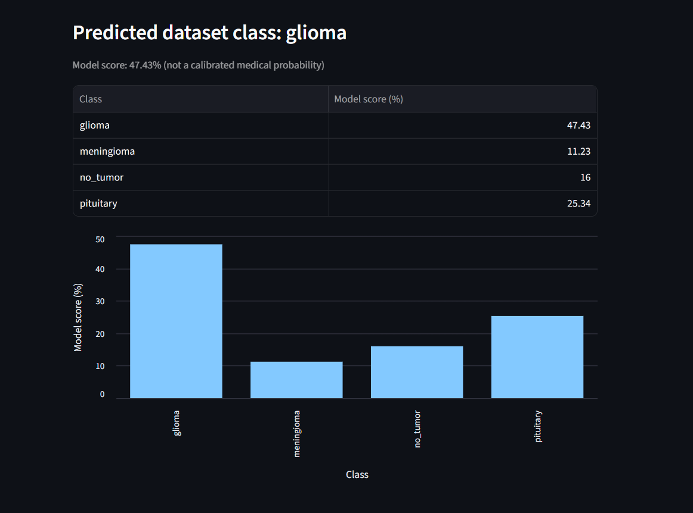

# 🧠 Brain Tumor MRI Image Classification

A deep learning project that classifies brain MRI images into four dataset categories using a **Custom Convolutional Neural Network (CNN)** and **MobileNetV2 transfer learning**. The project includes model training, performance evaluation, and a Streamlit web application for image-based predictions.

> **Disclaimer:** This project is intended for educational and research purposes only. It is not a clinically validated diagnostic system and must not be used to diagnose medical conditions or guide treatment decisions.

## 📌 Table of Contents

- [Project Overview](#-project-overview)
- [Objectives](#-objectives)
- [Technologies Used](#-technologies-used)
- [Dataset](#-dataset)
- [Project Structure](#-project-structure)
- [Model Performance](#-model-performance)
- [Installation and Setup](#-installation-and-setup)
- [Running the Application](#-running-the-application)
- [How to Use](#-how-to-use)
- [Limitations and Future Improvements](#-limitations-and-future-improvements)
- [Disclaimer](#-disclaimer)

## 🔍 Project Overview

Brain MRI image classification is an image recognition task in which a deep learning model learns visual patterns from labeled MRI images.

This project compares two approaches:

1. **Custom CNN:** A convolutional neural network trained on the project dataset.
2. **MobileNetV2:** A transfer learning approach using a pretrained convolutional neural network.

A Streamlit interface allows users to upload an MRI image and view the model's predicted dataset class along with the scores for all four classes.

## 🎯 Objectives

- Prepare and load a labeled MRI image dataset.
- Train a Custom CNN for multiclass image classification.
- Apply transfer learning using MobileNetV2.
- Evaluate both models using accuracy, precision, recall, F1-score, classification reports, and confusion matrices.
- Compare model performance on the held-out test dataset.
- Develop a Streamlit application for image upload and model inference.
- Save the trained model and class-label mapping for reuse.

## 🛠️ Technologies Used

| Technology           | Purpose                               |
| -------------------- | ------------------------------------- |
| Python               | Core programming language             |
| TensorFlow / Keras   | Deep learning and model training      |
| NumPy                | Numerical operations                  |
| Pandas               | Tabular data and result analysis      |
| Matplotlib / Seaborn | Visualizations and confusion matrices |
| Scikit-learn         | Classification metrics and evaluation |
| Pillow (PIL)         | Image loading and preprocessing       |
| Streamlit            | Interactive web application           |
| Jupyter Notebook     | Model development and experimentation |

## 📂 Dataset

The dataset contains brain MRI images organized into four classes:

- **Glioma**
- **Meningioma**
- **No Tumor**
- **Pituitary**

The uploaded dataset contains **2,443 images**, organized into predefined training, validation, and test splits.

| Split      | Number of images |
| ---------- | ---------------: |
| Training   |            1,695 |
| Validation |              502 |
| Testing    |              246 |
| **Total**  |        **2,443** |

### Dataset Directory Structure

```text
Tumour/
├── train/
│   ├── glioma/
│   ├── meningioma/
│   ├── no_tumor/
│   └── pituitary/
├── valid/
│   ├── glioma/
│   ├── meningioma/
│   ├── no_tumor/
│   └── pituitary/
└── test/
    ├── glioma/
    ├── meningioma/
    ├── no_tumor/
    └── pituitary/
```

Each class directory contains images belonging to that category. The notebook's `DATA_DIR` variable should point to the extracted `Tumour` directory.

**Dataset note:** Retain the original dataset attribution and license information when redistributing the dataset or derived materials.

## 🏗️ Project Structure

```text
Brain_Tumor_MRI_Classification/
├── Brain_Tumor_MRI_Classification_Final_Dataset_Ready.ipynb
├── app.py
├── requirements.txt
├── README.md
├── artifacts/
│   ├── class_names.json
│   ├── custom_cnn_best.keras
│   ├── custom_cnn_final.keras
│   ├── mobilenetv2_best.keras
│   └── mobilenetv2_final.keras
└── Tumour/
    ├── train/
    ├── valid/
    └── test/
```

_Note: The `.h5` model exports may also be present. The directory listing above represents the main project files, not a requirement to commit every generated artifact._

## 🧪 Model Performance

Both models were evaluated on the held-out test split containing 246 images.

### Test Results

| Metric             | Custom CNN | MobileNetV2 |
| ------------------ | ---------: | ----------: |
| Accuracy           |     83.74% |      81.30% |
| Weighted Precision |     84.72% |      86.57% |
| Weighted Recall    |     83.74% |      81.30% |
| Weighted F1-score  |     82.81% |      81.57% |

### Results Interpretation

- The Custom CNN achieved higher test accuracy and weighted F1-score in the recorded evaluation.
- MobileNetV2 achieved higher weighted precision.
- Performance varies across classes; the meningioma class showed comparatively low recall in both models.
- Accuracy alone does not fully describe multiclass classification performance. Class-wise precision, recall, F1-score, and confusion matrices should also be considered.

Based on these recorded metrics, the **Custom CNN is the current primary model for the Streamlit demonstration**.

These results describe the current experiment and do not establish clinical performance or generalization to MRI images from other datasets, scanners, or institutions.

## ⚙️ Installation and Setup

### Prerequisites

- Python installed on your system
- Git (optional, for repository management)
- The extracted MRI dataset
- The project notebook and application files

### 1. Clone or Download the Project

If the project is hosted on GitHub:

```bash
git clone <YOUR_REPOSITORY_URL>
cd Brain_Tumor_MRI_Classification
```

Alternatively, open the project directory you already have locally.

### 2. Create a Virtual Environment

**Windows:**

```bash
python -m venv .venv
.venv\Scripts\activate
```

**macOS / Linux:**

```bash
python3 -m venv .venv
source .venv/bin/activate
```

### 3. Install Dependencies

```bash
python -m pip install -r requirements.txt
```

Ensure that the installed TensorFlow version is compatible with your Python version and operating system.

### 4. Configure the Dataset Path

Open the notebook and update `DATA_DIR` if your extracted dataset is located elsewhere.

For example:

```python
from pathlib import Path

DATA_DIR = Path("./Tumour")
```

### 5. Train or Load the Models

Run the notebook cells in order to perform dataset inspection, training, evaluation, and model export.

The notebook generates model artifacts and the class-label mapping required for inference. If you already have the verified saved models, you can proceed directly to the application setup.

## 🚀 Running the Application

Make sure the selected model and `class_names.json` are available in the `artifacts/` directory.

Start the Streamlit application from the project root:

```bash
python -m streamlit run app.py
```

Streamlit will display a local URL in the terminal. Open that URL in your browser.

## 🖥️ How to Use

1. Launch the Streamlit application.
2. Upload an MRI image in a supported format.
3. View the uploaded image.
4. Review the predicted dataset class.
5. Compare the displayed model scores across the four classes.

The application currently uses the saved Custom CNN model and its class-label mapping.

**Important:** The displayed model score is not a calibrated medical probability. A high score does not confirm the presence or absence of a tumor.

## 📸 Application Screenshots

### Home Page



### Prediction Result



## ⚠️ Limitations and Future Improvements

### Current Limitations

- The model has been evaluated on the available dataset only.
- Class-wise performance is uneven, particularly for meningioma recall.
- Predictions can be affected by image quality, preprocessing, dataset bias, and differences between data sources.
- The application is not validated for clinical use.
- Performance on external datasets has not been established.

### Future Improvements

- Investigate misclassified images and possible dataset-label issues.
- Improve class-wise performance using validation-driven experiments and appropriate data augmentation.
- Evaluate additional architectures and compare macro as well as weighted metrics.
- Perform external validation on an independent dataset.
- Improve inference logging, error handling, and automated testing.
- Consider model calibration and uncertainty estimation for research purposes.

## 🚀 Live Demo

**Try the deployed application:**  
[Brain Tumor MRI Classification — Live App](https://brain-tumor-mri-classification-xptm4b2fgpzw6nf6mw2uqz.streamlit.app)

**Source Code:**  
[GitHub Repository](https://github.com/ritikatripathi11111/Brain-Tumor-MRI-Classification)

Upload an MRI image to view the model's predicted class and confidence scores.

## ⚕️ Disclaimer

This project is an educational deep learning prototype. It is **not a medical device** and has not been validated for clinical diagnosis.

Predictions must not be used to make medical decisions, determine treatment, or replace assessment by a qualified healthcare professional.

Always consult a qualified medical professional regarding medical concerns.
